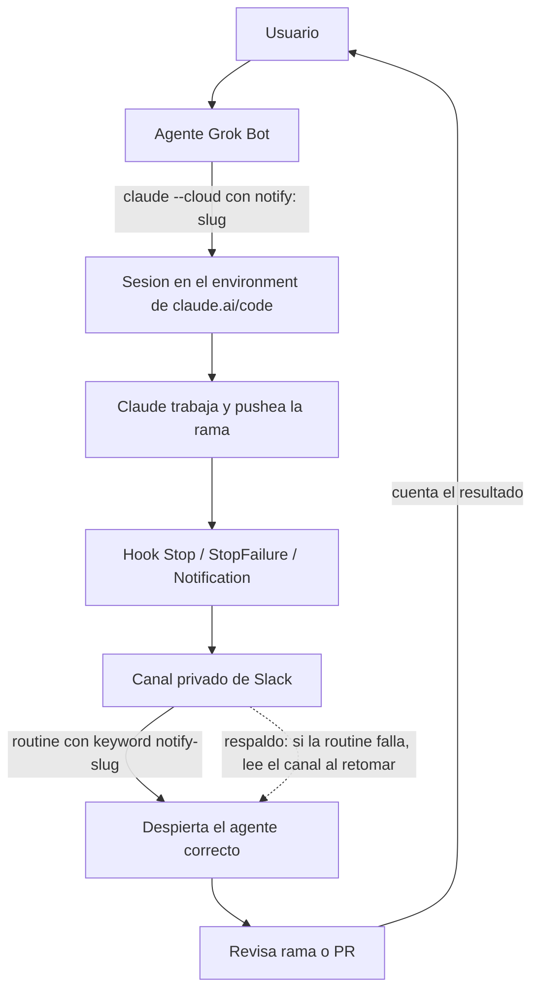

  
  
  

# Conecta grokbot con claude-code

Notificaciones de Claude Code (nube por defecto, local como fallback) hacia agentes de Grok Bot vía Slack.

Los agentes de Grok Bot delegan código a Claude Code —por defecto en la nube (claude.ai/code, `claude --cloud`), o en la computadora compartida como fallback— y se enteran cuando Claude termina o necesita input, **sin polling y sin un bot relay que gaste tokens**: hooks de Claude Code publican un mensaje en un canal privado de Slack y cada agente tiene una routine que despierta solo con su keyword.

> **English summary.** Claude Code hooks (`Stop`, `StopFailure`, `Notification`, `PermissionRequest`, `SessionEnd`) post a short Slack mrkdwn message (a `*Claude Code*` title, then one `• *field:* value` line per field, built deterministically in bash; posted as username "Claude Code" with the Claude icon) to a private Slack channel using a dedicated bot token (`chat:write`, plus `chat:write.customize` for the custom name/icon). Each Grok Bot agent has a routine with a Slack keyword trigger (`notify-<agent-slug>`), so only the right agent wakes up. A small wrapper (`local/notify-run`) covers what hooks can't (SIGKILL, OOM, crashes). Cloud is the default (claude.ai/code environments via `claude --cloud`, token injected by Anthropic's proxy as a network secret); local runs on the shared machine (token in env/config file) are the fallback. Docs are in Spanish.

  
  
  

## Cómo funciona

1. Le pedís una tarea de código a tu agente de Grok Bot.
2. El agente lanza `claude --cloud` con la línea `notify: <slug>` en el prompt y la regla de rama gitflow (`feature/`, `hotfix/` o `release/`; nunca `claude/` ni `cursor/`).
3. Claude Code trabaja en una sesión de la nube (el environment de claude.ai/code) y pushea la rama.
4. Al terminar o necesitar input, un hook (`Stop`, `StopFailure`, `Notification`, ...) publica un mensaje en un canal privado de Slack.
5. La routine de Grok Bot con keyword `notify-<slug>` despierta solo al agente correcto.
6. El agente revisa la rama o el PR y te cuenta.

Respaldo: si la routine falla, el agente lee el canal cuando retoma la tarea.

## Documentación

| Documento | Contenido |
| :- | :- |
| [Instalación](docs/instalacion.md) | Claude Code en la computadora de los bots, Slack, nube (environment, modelo), local, onboarding de cada agente, skill, SessionStart y prompts para replicar el setup. |
| [Problemas comunes](docs/problemas-comunes.md) | Síntomas frecuentes y cómo resolverlos. |
| [Detalles técnicos](docs/detalles-tecnicos.md) | Formato del mensaje y payload, contenido del repo, comportamiento verificado, huecos conocidos y tests. |

Skills: [`skill/claude-code-task/SKILL.md`](skill/claude-code-task/SKILL.md) (correr, continuar y leer tareas) y [`skill/claude-code-notify-setup/SKILL.md`](skill/claude-code-notify-setup/SKILL.md) (onboarding).

## Autor

**Luciano Rodriguez**, GenAI Software Engineer (SSr) en Mercado Libre, Buenos Aires, Argentina. Trabaja en productividad de desarrollo, diseñando herramientas con IA que se adaptan a cómo construyen software los equipos. Está terminando Ingeniería en Sistemas de Información en la UTN. Construye [Ágora](https://www.agorasynth.com/), focus groups con agentes sintéticos, y Ray, un agente de IA que busca trabajo por vos.

[GitHub](https://github.com/luck-prg) · [X](https://x.com/luchoorocker)

## Créditos

- Eventos y campos de hooks según la [referencia de hooks de Claude Code](https://code.claude.com/docs/en/hooks).
