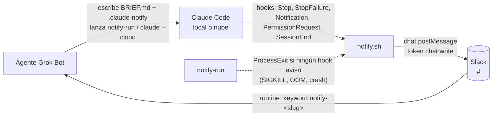

# grokbot-claude-code

Notificaciones de Claude Code (local y nube) hacia agentes de Grok Bot vía Slack.

Los agentes de Grok Bot delegan código a Claude Code —en la computadora compartida o en la nube (claude.ai/code)— y se enteran cuando Claude termina o necesita input, **sin polling y sin un bot relay que gaste tokens**: hooks de Claude Code publican un mensaje en un canal privado de Slack y cada agente tiene una routine que despierta solo con su keyword.

> **English summary.** Claude Code hooks (`Stop`, `StopFailure`, `Notification`, `PermissionRequest`, `SessionEnd`) post a short Slack mrkdwn message (3-4 lines, built deterministically in bash) to a private Slack channel using a dedicated `chat:write` bot token. Each Grok Bot agent has a routine with a Slack keyword trigger (`notify-<agent-slug>`), so only the right agent wakes up. A small wrapper (`local/notify-run`) covers what hooks can't (SIGKILL, OOM, crashes). Works locally (token in env/config file) and in claude.ai/code cloud environments (token injected by Anthropic's proxy as a network secret). Docs are in Spanish.

## Cómo funciona



Mensaje publicado:

```
🤖 *Claude Code* · `Stop` · <https://claude.ai/code/abc|sesión>
repo `owner/name` · rama `feature/x` · agente `notify-dev-fe` · tarea `t`
> resumen de una línea…
notify-dev-fe event=Stop task=t session=<session_id o url> branch=feature/x
```

Se publica como un solo campo `text` (sin `blocks`), así el keyword `notify-<slug>` queda en el texto que matchea la routine.

- **Línea 1:** evento y, si hay, su detalle: `` `StopFailure` · `error=rate_limit` ``, `type=permission_prompt` (Notification), `tool=Bash` (PermissionRequest), `reason=other` (SessionEnd), `exit=137` (ProcessExit). La sesión es un link `<url|sesión>` en la nube y el id en código (`` `id` ``) en local.
- **Línea 2:** repo `owner/name` (del `git remote get-url origin`; soporta https y ssh, quita `.git` y nunca muestra credenciales ni host), rama, agente (`notify-<slug>`, el keyword de la routine) y tarea. Los campos vacíos o `-` se omiten.
- **Línea 3:** `> resumen` de una línea, recortado a 140 caracteres + `…`. Se omite si no hay.
- **Línea 4:** campos legibles por máquina en texto plano: `notify-<slug> event=<evento>[ detalle] task=<tarea> session=<id|url> branch=<rama>`. Es la que deben parsear routines y skills (con `-` en los campos vacíos).

**A quién avisar:** archivo `.claude-notify` en la carpeta de trabajo o en la raíz del repo/worktree, escrito por el agente al lanzar la tarea:

```
NOTIFY_AGENT=<agent-slug>
NOTIFY_TASK=<nombre-de-la-tarea>
```

Si no existe, se usan las variables de entorno `NOTIFY_AGENT` / `NOTIFY_TASK`. Si no hay agente, no se envía nada.

El único `notify-` real del mensaje es el keyword del principio: en el resto (resumen, tarea, rama, repo, detalle) cada `notify-` se reemplaza por `notify‐` (guion U+2010) y `&`, `<`, `>` se escapan, así un resumen no puede despertar a otro agente ni hacer ping con `<!channel>`, `<@U…>` o `<#C…>`.

## Contenido

| Ruta | Qué es |
| :- | :- |
| `hooks/notify.sh` | El hook. Lee el JSON de stdin, filtra, deduplica y publica. Siempre sale 0. Usa `jq`; sin `jq` tiene un fallback con `sed`/`awk` pensado como red de seguridad, no como modo normal. |
| `hooks/settings.json` | Bloque `hooks` para `~/.claude/settings.json` o `.claude/settings.json`. |
| `local/install.sh` | Instalación local: copia el hook a `~/.claude/hooks/grokbot-notify.sh`, `notify-run` a `~/.local/bin`, mergea los hooks con `jq` sin pisar lo existente y crea `~/.config/grokbot-claude-code/env` (modo 600) con placeholders. |
| `local/notify-run` | Wrapper de `claude` (argumentos tal cual). Si al salir ningún hook avisó, publica `event=ProcessExit exit=<código>`. |
| `cloud/setup.sh` | Setup script auto-contenido para environments de claude.ai/code (embebe `notify.sh`). Generado con `bash cloud/build.sh`. |
| `skill/claude-code-task/SKILL.md` | Skill de Grok Bot actualizada: flujos local y nube, `.claude-notify`, `notify-run`, routine, sin polling. |
| `skill/claude-code-notify-setup/SKILL.md` | Skill de onboarding (una vez por agente): elegir `notify-<slug>`, crear la routine, guardarlo en memoria y probar que dispara. |
| `tests/simulate.sh` | Tests sin red (`DRY_RUN=1`). |

## Setup

### 1. Slack

1. Creá un canal **privado** `#<canal>` y anotá su channel id (`C0123456789`; en Slack: detalles del canal → abajo de todo).
2. Creá una Slack app dedicada (https://api.slack.com/apps → *From scratch*). En *OAuth & Permissions* agregá **solo** el bot scope `chat:write`. Instalala en el workspace y copiá el *Bot User OAuth Token* (`xoxb-...`).
3. En `#<canal>`: `/invite @<tu-app>` y `/invite @Cursor` (la app que dispara las routines de Grok Bot tiene que ver los mensajes del canal). No invites el bot de notificaciones a ningún otro canal.

El token solo puede escribir en canales donde el bot es miembro, así que si se filtra el daño queda acotado a ese canal. Igual, tratalo como secreto: nunca en el repo.

### 2. Local (computadora compartida)

```bash
git clone <este-repo> ~/grokbot-claude-code
bash ~/grokbot-claude-code/local/install.sh
chmod 600 ~/.config/grokbot-claude-code/env
$EDITOR ~/.config/grokbot-claude-code/env   # SLACK_NOTIFY_TOKEN=xoxb-... y SLACK_NOTIFY_CHANNEL=C...
```

**`jq` es en la práctica obligatorio**: `local/install.sh` lo usa para mergear los hooks y el hook lo usa para parsear el JSON. El fallback sin `jq` cubre los casos de los tests, pero no es un parser JSON completo.

Las variables `SLACK_NOTIFY_TOKEN` / `SLACK_NOTIFY_CHANNEL` del entorno ganan sobre el archivo. El hook envía el token por un descriptor de archivo, no por la línea de comandos (no aparece en `ps`).

Probar sin red:

```bash
cd /tmp && printf 'NOTIFY_AGENT=prueba\nNOTIFY_TASK=demo\n' > .claude-notify
echo '{"session_id":"s1","cwd":"/tmp","hook_event_name":"Stop","last_assistant_message":"hola"}' \
  | DRY_RUN=1 bash ~/.claude/hooks/grokbot-notify.sh
```

Sin `DRY_RUN` publica de verdad. Log: `${XDG_STATE_HOME:-~/.local/state}/grokbot-claude-code/notify.log` (directorio privado del usuario, creado con `umask 077`; se cambia con `NOTIFY_STATE_DIR`).

### 3. Nube (claude.ai/code environments)

En la configuración del environment:

1. **Network access:** *Custom*, permitir `slack.com` (y dejar los package managers por defecto).
2. **Network secret:** tipo Bearer para el host `slack.com`, con el token `xoxb-...`. El proxy de Anthropic inyecta el header `Authorization` en las requests de la sesión. Los secretos matchean **solo por host**, no por path, y el proxy **no** los agrega a requests del setup script (no intentes probar el envío ahí). Cuando no hay `SLACK_NOTIFY_TOKEN` en el env y `CLAUDE_CODE_REMOTE=true`, el hook no manda su propio header.
3. **Variables de entorno:** `SLACK_NOTIFY_CHANNEL=C0123456789` y, si el environment es de un solo agente, `NOTIFY_AGENT=<agent-slug>`.
4. **Setup script:** pegá entero el contenido de [`cloud/setup.sh`](cloud/setup.sh). Escribe el hook y mergea `~/.claude/settings.json` dentro de la VM.

`.claude-notify` no viaja a la nube porque no se commitea: usá `NOTIFY_AGENT` en el environment o pedile a Claude, al inicio del prompt, que cree `.claude-notify` sin commitearlo.

**Verificado en una sesión real de la nube (2026-10-14), de punta a punta:**

- El network secret (Bearer para `slack.com`) **sí** se inyecta en la request que hace el hook durante la sesión: el aviso llegó al canal sin `SLACK_NOTIFY_TOKEN` en el env de la VM.
- La variable de entorno `SLACK_NOTIFY_CHANNEL` del environment llega al setup script, que la escribe en `~/.config/grokbot-claude-code/env`; con eso alcanza para el canal.
- El aviso real llevó un session id en `session=`. El hook igual mantiene el fallback: `https://claude.ai/code/$CLAUDE_CODE_REMOTE_SESSION_ID` si esa variable existe, si no el `session_id` del JSON del hook.

### 4. Onboarding de cada agente (routine)

Cada agente Grok Bot se configura una vez con la skill [`skill/claude-code-notify-setup/SKILL.md`](skill/claude-code-notify-setup/SKILL.md): elige su slug, crea una routine con trigger Slack por keyword `notify-<slug>`, lo guarda en su memoria y prueba que dispara. Así solo despierta ese agente (filtro determinístico, sin LLM en el medio).

**Regla de colisión por substring:** la routine matchea el keyword como substring del mensaje, así que el keyword de un agente no puede estar contenido en el de otro ni contenerlo. `notify-dev` y `notify-dev-ml` chocan: un aviso para `notify-dev-ml` despierta también a `notify-dev`. Antes de asignar slugs, revisá los `notify-...` que ya se usan en el canal.

Requisito: `@Cursor` invitado al canal de avisos (paso 1).

Prompt para mandarle a cada agente (completá `<canal>` y `<slug>`; usá un slug distinto por agente):

```text
Configurate para que te despierten los avisos de Claude Code, siguiendo la skill claude-code-notify-setup (skill/claude-code-notify-setup/SKILL.md del repo grokbot-claude-code).
- Canal de avisos: #<canal>
- Slug propuesto: <slug> (tu keyword sería notify-<slug>). Antes de usarlo, chequeá que no sea substring del keyword de otro agente ni contenga uno (p.ej. notify-dev vs notify-dev-ml chocan); mirá los notify-... que ya aparecen en #<canal> y, si hay duda, preguntá y proponé otro.
Pasos: 1) confirmá el slug; 2) creá en vos una routine con trigger {"type":"slack","channel":"#<canal>","match":{"kind":"keyword","keyword":"notify-<slug>"}} cuya instrucción lea el aviso (la última línea trae event, task, session y branch; el resumen es la línea que empieza con `>`) y continúe o reporte la tarea sin cambiar nada fuera de su alcance; 3) guardá el slug en tu memoria y usalo como NOTIFY_AGENT al lanzar tareas; 4) hacé una sola prueba y confirmá que tu routine disparó; 5) reportame keyword, canal y resultado de la prueba.
No pegues tokens en el chat ni en ningún repo. No hagas polling.

### 5. Skill

Reemplazá la skill `claude-code-task` de Grok Bot por [`skill/claude-code-task/SKILL.md`](skill/claude-code-task/SKILL.md).

### SessionStart (opcional)

Desactivado por defecto. Para avisar también al arrancar una sesión, agregá a `settings.json`:

```json
"SessionStart": [
  { "hooks": [ { "type": "command", "command": "bash \"$HOME/.claude/hooks/grokbot-notify.sh\"", "timeout": 15 } ] }
]
```

y exportá `NOTIFY_SESSION_START=1`. Para quitarlo, borrá ese bloque.

## PROMPT para que un agente Grok Bot replique el setup

Copiá y pegá (completando los placeholders; el token pasalo por un canal seguro, no en el chat):

```text
Configurá las notificaciones de Claude Code para vos usando el repo grokbot-claude-code.
1. Cloná el repo en ~/grokbot-claude-code (si ya existe, hacé git pull) y corré: bash ~/grokbot-claude-code/local/install.sh
2. Verificá que ~/.config/grokbot-claude-code/env tenga modo 600 y que SLACK_NOTIFY_TOKEN y SLACK_NOTIFY_CHANNEL tengan valores reales (canal: C0123456789). Si el token sigue en xoxb-REPLACE_ME, pedíselo al dueño; no lo escribas en ningún repo ni mensaje.
3. Tu slug es <agent-slug>. Seguí ~/grokbot-claude-code/skill/claude-code-notify-setup/SKILL.md para chequear que no colisione por substring con otro keyword y crear la routine con trigger {type:'slack', channel:'#<canal>', match:{kind:'keyword', keyword:'notify-<agent-slug>'}}.
4. Reemplazá tu skill claude-code-task por ~/grokbot-claude-code/skill/claude-code-task/SKILL.md.
5. Probá: en una carpeta temporal escribí .claude-notify con NOTIFY_AGENT=<agent-slug> y NOTIFY_TASK=prueba, y corré ahí: notify-run -p "Respondé solo: hola" < /dev/null. Confirmá que tu routine se disparó con event=Stop. Si no, revisá ${XDG_STATE_HOME:-~/.local/state}/grokbot-claude-code/notify.log y avisá al dueño.
No hagas polling, no mergees, no hagas push de nada en este repo.
```

## Comportamiento verificado

Verificado con `claude -p` real en Linux (Stop + dedup de SessionEnd, Stop en pausa + SIGKILL → ProcessExit), con experimentos previos de hooks (SessionEnd en SIGINT/SIGTERM, subagentes con `agent_id`) y con `tests/simulate.sh` + la referencia de hooks para el resto.

| Situación | Qué se publica |
| :- | :- |
| Fin normal del turno (`claude -p`) | `event=Stop` con el último mensaje como resumen. El `SessionEnd` siguiente se descarta (dedup por sesión). |
| Stop con tareas en segundo plano o crons pendientes (`background_tasks`/`session_crons`) | Nada: la sesión está en pausa. Avisa el Stop final, el `SessionEnd` o el `ProcessExit`. |
| Error de API / rate limit / usage limit | `event=StopFailure error=<tipo>`. |
| Pide permiso | `event=PermissionRequest tool=<tool>` al instante, con `> <tool>` como resumen (nunca el `tool_input`: el comando puede traer credenciales). El `Notification permission_prompt` posterior (≈6 s) se descarta si hubo PermissionRequest en los últimos 120 s. |
| Elicitation MCP / sesión interactiva ociosa | `event=Notification type=elicitation_dialog\|elicitation_url_dialog\|idle_prompt` (idle se descarta si ya hubo Stop en ese turno). |
| `--max-turns`, SIGINT/SIGTERM, salida sin Stop | `event=SessionEnd reason=<motivo>` (timeout del hook 10 s; el default de SessionEnd es 1.5 s). |
| SIGKILL / OOM / crash (con `notify-run`) | `event=ProcessExit exit=<código>` (p.ej. 137), con el session_id si algún hook llegó a verlo. |
| Subagentes | Nada: se descarta todo evento con `agent_id`. No se usa `SubagentStop`. |
| Sin `.claude-notify` ni `NOTIFY_AGENT` | Nada (exit 0). |

El hook nunca bloquea ni hace fallar a Claude: siempre sale 0 y no escribe JSON de decisión en stdout. Estado de dedup y log en `${XDG_STATE_HOME:-~/.local/state}/grokbot-claude-code/` (privado del usuario, no en `/tmp`). La marca de dedup se escribe solo si el envío salió bien.

### Huecos conocidos

- **SIGKILL/OOM/crash sin `notify-run`** (o si muere el propio `notify-run`): no hay aviso. En la nube no hay wrapper; depende de los hooks.
- **Sesiones interactivas largas:** cada turno avisa con `Stop` (dedup por `prompt_id`), lo que puede ser ruidoso.
- **`session=` en la nube:** usa `https://claude.ai/code/$CLAUDE_CODE_REMOTE_SESSION_ID` si esa variable existe; si no, el `session_id` del hook. Un aviso real desde la nube llevó un session id; el fallback se mantiene por si cambia.
- **Keyword por substring:** si el keyword de un agente está contenido en el de otro (`notify-dev` / `notify-dev-ml`), despierta al agente equivocado. Ver [onboarding](#4-onboarding-de-cada-agente-routine).
- Si Slack responde error (token inválido, bot fuera del canal), solo queda en `notify.log`. `curl` usa `--connect-timeout 3 --max-time 4` y un reintento ante errores transitorios; si igual falla, no queda marca de dedup y el próximo evento terminal (o el `ProcessExit` de `notify-run`) vuelve a intentar.

## Tests

```bash
bash tests/simulate.sh
shellcheck hooks/notify.sh local/notify-run local/install.sh cloud/build.sh cloud/setup.sh tests/simulate.sh
```

Si cambiás `hooks/notify.sh` o `hooks/settings.json`, regenerá `cloud/setup.sh` con `bash cloud/build.sh` (el test falla si queda desactualizado).

## Créditos

- `local/notify-run` está inspirado en [wake-on-done de eze-grokbot](https://github.com/eze-is/eze-grokbot/tree/main/wake-on-done).
- Eventos y campos de hooks según la [referencia de hooks de Claude Code](https://code.claude.com/docs/en/hooks).
