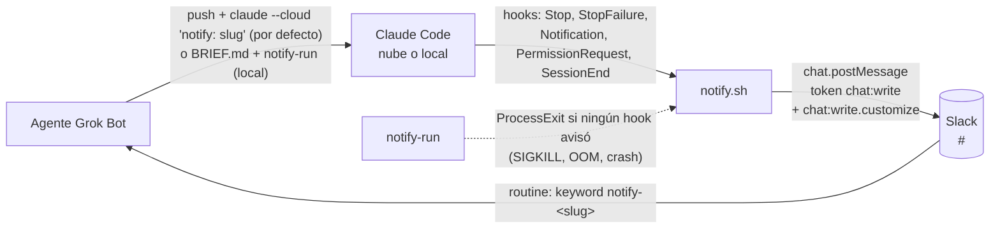

# grokbot-claude-code

Notificaciones de Claude Code (nube por defecto, local como fallback) hacia agentes de Grok Bot vía Slack.

Los agentes de Grok Bot delegan código a Claude Code —por defecto en la nube (claude.ai/code, `claude --cloud`), o en la computadora compartida como fallback— y se enteran cuando Claude termina o necesita input, **sin polling y sin un bot relay que gaste tokens**: hooks de Claude Code publican un mensaje en un canal privado de Slack y cada agente tiene una routine que despierta solo con su keyword.

> **English summary.** Claude Code hooks (`Stop`, `StopFailure`, `Notification`, `PermissionRequest`, `SessionEnd`) post a short Slack mrkdwn message (a `*Claude Code*` title, then one `• *field:* value` line per field, built deterministically in bash; posted as username "Claude Code" with the Claude icon) to a private Slack channel using a dedicated bot token (`chat:write`, plus `chat:write.customize` for the custom name/icon). Each Grok Bot agent has a routine with a Slack keyword trigger (`notify-<agent-slug>`), so only the right agent wakes up. A small wrapper (`local/notify-run`) covers what hooks can't (SIGKILL, OOM, crashes). Cloud is the default (claude.ai/code environments via `claude --cloud`, token injected by Anthropic's proxy as a network secret); local runs on the shared machine (token in env/config file) are the fallback. Docs are in Spanish.

## Cómo funciona



Mensaje publicado:

```
*Claude Code*
• *evento:* `StopFailure` · `error=rate_limit`
• *sesión:* <https://claude.ai/code/session_abc|session_abc>
• *repo:* `owner/name`
• *rama:* `feature/x`
• *agente:* `notify-dev-fe`
• *tarea:* `x`
```

Se publica como un solo campo `text` (sin `blocks`), así el keyword `notify-<slug>` queda en el texto que matchea la routine. Un campo por línea, el mismo texto sirve para personas, scripts y agentes:

- **Título:** siempre `*Claude Code*` (sin emoji ni viñeta). Cada línea de campo empieza con `• ` (U+2022 + espacio).
- **`evento`:** siempre. Si hay detalle va en un segundo span en la misma línea: `error=rate_limit` (StopFailure), `type=permission_prompt` (Notification), `tool=Bash` (PermissionRequest), `reason=other` (SessionEnd), `exit=137` (ProcessExit).
- **`sesión`:** en la nube, link a la sesión cuyo texto es el id: `<https://claude.ai/code/session_xxx|session_xxx>`; en local, el `session_id` en código (`` `id` ``).
- **`repo`:** `owner/name` del `git remote get-url origin` (soporta https y ssh, quita `.git` y nunca muestra credenciales ni host).
- **`rama`**, **`agente`** (`notify-<slug>`, el keyword de la routine; `desconocido` si no se sabe) y **`tarea`** (la rama sin el prefijo `feature/`, `hotfix/` o `release/`: `feature/x` → `x`; otra rama queda igual; sin rama, p.ej. HEAD detached, no hay tarea).
- Los campos vacíos o `-` se omiten con su línea (p.ej. sin remote no hay `*repo:*`).

**Cómo parsearlo:** cada línea después del título es `• *<campo>:* <valor>` (regex `^• \*([^*]+):\* (.*)$`); el valor va entre backticks o, en `sesión` en la nube, como `<url|session_xxx>` (la URL es lo que está entre `<` y `|`; el texto del link, entre `|` y `>`, es el id de sesión). La routine identifica al agente por la línea `*agente:*` `` `notify-<slug>` ``.

**Payload de `chat.postMessage`** (ejemplo con los defaults):

```json
{"channel":"C0123456789","text":"*Claude Code*\n• *evento:* `Stop`\n• *sesión:* `s1`\n• *agente:* `notify-dev-fe`","username":"Claude Code","icon_url":"https://claude.ai/images/claude_app_icon.png"}
```

`username` (default `Claude Code`, se cambia con `SLACK_NOTIFY_USERNAME`) e `icon_url` (default `https://claude.ai/images/claude_app_icon.png`, se cambia con `SLACK_NOTIFY_ICON_URL`) van siempre, con y sin `jq`. Para que Slack los use, el bot necesita el scope **`chat:write.customize`**; sin él Slack los ignora **sin dar error** y el mensaje sale con el nombre e ícono de la app.

**A quién avisar:** el prompt de la tarea lleva una línea sola `notify: <agent-slug>`, p.ej.:

```
notify: dev-fe
Arreglá el login roto. No toques la base. Commiteá y hacé push de la rama.
```

El hook lee el `transcript_path` del JSON del hook y busca esa línea (`^[[:space:]]*notify:[[:space:]]*([a-z0-9-]+)[[:space:]]*$`) en el **primer** mensaje del usuario de la sesión (se saltean los mensajes meta, de sidechain y los `tool_result`; el contenido puede ser texto o bloques `text`). Una línea `notify:` en un mensaje posterior no cuenta. No hace falta crear archivos ni variables por tarea, así que funciona igual en la nube y en local, y varias sesiones en la misma rama pueden avisar a agentes distintos.

Si el primer mensaje no la trae, se usa la variable de entorno `NOTIFY_AGENT`. Si tampoco está, **igual se avisa**, con `` • *agente:* `desconocido` `` y sin ningún keyword `notify-`: el aviso queda en el canal pero no despierta a nadie.

El único `notify-` real del mensaje es el keyword de la línea `*agente:*`: en el resto (tarea, rama, repo, detalle) cada `notify-` se reemplaza por `notify‐` (guion U+2010) y `&`, `<`, `>` se escapan, así una tarea o una rama no pueden despertar a otro agente ni hacer ping con `<!channel>`, `<@U…>` o `<#C…>`.

## Contenido

| Ruta | Qué es |
| :- | :- |
| `hooks/notify.sh` | El hook. Lee el JSON de stdin, filtra, deduplica y publica. Siempre sale 0. Usa `jq`; sin `jq` tiene un fallback con `sed`/`awk` pensado como red de seguridad, no como modo normal. |
| `hooks/settings.json` | Bloque `hooks` para `~/.claude/settings.json` o `.claude/settings.json`. |
| `local/install.sh` | Instalación local: copia el hook a `~/.claude/hooks/grokbot-notify.sh`, `notify-run` a `~/.local/bin`, mergea los hooks con `jq` sin pisar lo existente y crea `~/.config/grokbot-claude-code/env` (modo 600) con placeholders. `--uninstall` los saca. |
| `local/notify-run` | Wrapper de `claude` (argumentos tal cual). Si al salir ningún hook avisó, publica un aviso `ProcessExit` · `exit=<código>`. |
| `local/check-slugs` | Chequea una lista de slugs (formato, duplicados y colisión por substring entre `notify-<a>` y `notify-<b>`). Sale 0 ok, 1 con problemas, 2 sin slugs. |
| `cloud/setup.sh` | Setup script auto-contenido para environments de claude.ai/code (embebe `notify.sh`). Generado con `bash cloud/build.sh`. |
| `cloud/build.sh` | Regenera `cloud/setup.sh`; con `--check` falla si quedó desactualizado. |
| `skill/claude-code-task/SKILL.md` | Skill de Grok Bot actualizada: nube por defecto (`claude --cloud`), local (worktree + `notify-run`) como fallback, línea `notify: <slug>` en el prompt, routine, sin polling. |
| `skill/claude-code-notify-setup/SKILL.md` | Skill de onboarding: le pregunta al usuario canal, channel id y bots; flujo coordinador (varios bots) o por agente; slugs chequeados con `local/check-slugs`, routine, memoria y una prueba por bot. |
| `tests/simulate.sh` | Simulación de eventos contra el hook sin red (`DRY_RUN=1`). |
| `tests/test-transcript-agent.sh` | Agente desde la línea `notify:` del transcript (fixtures en `tests/fixtures/`), fallbacks y tarea desde la rama, con y sin `jq`. |
| `tests/test-scripts.sh` | POST real del hook contra un servidor HTTP falso local, `notify-run`, `local/install.sh` (+ `--uninstall`), `cloud/build.sh` y `cloud/setup.sh` en un HOME temporal. |
| `tests/test-check-slugs.sh` | Casos de `local/check-slugs`. |
| `tests/lint-skills.sh` | Frontmatter de las skills, rutas del repo citadas, placeholders, canal sin hardcodear y nube por defecto en la skill de tareas. |
| `tests/secret-scan.sh` | Busca tokens/ids con pinta de reales en los archivos del repo. |
| `tests/run-all.sh` | Corre todos los tests y resume. |
| `ci/github-workflow-test.yml` | CI: `shellcheck` + `bash tests/run-all.sh` en cada PR y push a `main`. Movelo a .github/workflows/test.yml para activarlo. |

## Setup

### 0. Claude Code en la computadora de los bots

La computadora es **compartida por todos los bots**: se instala y se loguea una sola vez y la usan todos.

1. Instalá la CLI con el instalador oficial nativo (Linux/macOS/WSL; se actualiza solo):
   ```
   curl -fsSL https://claude.ai/install.sh | bash
   ```
   Deja el lanzador en `~/.local/bin/claude` (tiene que estar en el `PATH`).
2. Verificá: `claude --version` imprime algo como `2.1.xxx (Claude Code)`. Para un diagnóstico más completo: `claude doctor`.
3. Login con la cuenta de Claude del dueño (Pro, Max, Team o Enterprise), **una sola vez**, en la pantalla del bot: corré `claude` y seguí el login en el navegador (o `claude auth login`). Los bots no inician sesión por su cuenta.
4. Conectá GitHub para la nube: dentro de `claude`, corré `/web-setup` (manda tu token de `gh` a la cuenta de Claude; si no tenés environment, crea el *Default*). Alternativa: instalar la Claude GitHub App desde claude.ai/code.

### 1. Slack

1. Creá un canal **privado** `#<canal>` y anotá su channel id (`C0123456789`; en Slack: detalles del canal → abajo de todo).
2. Creá una Slack app dedicada (https://api.slack.com/apps → *From scratch*). En *OAuth & Permissions* agregá **solo** los bot scopes `chat:write` y `chat:write.customize` (este último para que el mensaje salga como "Claude Code" con el ícono de Claude; sin él Slack ignora `username`/`icon_url` sin dar error). Instalala en el workspace y copiá el *Bot User OAuth Token* (`xoxb-...`).
3. En `#<canal>`: `/invite @<tu-app>` y `/invite @Cursor` (la app que dispara las routines de Grok Bot tiene que ver los mensajes del canal). No invites el bot de notificaciones a ningún otro canal.

El token solo puede escribir en canales donde el bot es miembro, así que si se filtra el daño queda acotado a ese canal. Igual, tratalo como secreto: nunca en el repo.

### 2. Nube (claude.ai/code environments, por defecto)

Es el modo por defecto: el agente hace push de la rama y lanza `claude --cloud "<tarea>"` desde la carpeta del repo (desde un bot, que no tiene TTY: `script -qec 'claude --cloud "<tarea>"' /dev/null </dev/null`). Requiere GitHub conectado a la cuenta de Claude (`/web-setup` dentro de `claude`).

El environment se crea en claude.ai/code, en la pantalla de nueva sesión: el selector de environment es el primer control de la fila debajo de la caja de mensaje → *New environment* (para editar uno existente: su fila bajo *Cloud* → ícono de configuración). Sugerencia de nombre: `<nombre-entorno>` (p.ej. `grokbot-notify`).

Duda: según la documentación, la CLI elige el environment con `/remote-env` (lo guarda en `remote.defaultEnvironmentId` de tus settings) y, si no elegiste, cae al environment alojado por Anthropic o al primero de la lista. No probamos `/remote-env` en esta computadora; si el aviso no llega, revisalo ahí.

En la configuración del environment:

1. **Network access:** *Custom*, permitir `slack.com` (y dejar los package managers por defecto).
2. **Network secret:** tipo Bearer para el host `slack.com`, con el token `xoxb-...`. El proxy de Anthropic inyecta el header `Authorization` en las requests de la sesión. Los secretos matchean **solo por host**, no por path, y el proxy **no** los agrega a requests del setup script (no intentes probar el envío ahí). Cuando no hay `SLACK_NOTIFY_TOKEN` en el env y `CLAUDE_CODE_REMOTE=true`, el hook no manda su propio header.
3. **Variables de entorno:** `SLACK_NOTIFY_CHANNEL=C0123456789`. Opcional: `NOTIFY_AGENT=<agent-slug>` como fallback si el environment es de un solo agente (la línea `notify:` del prompt gana).
4. **Setup script:** pegá entero el contenido de [`cloud/setup.sh`](cloud/setup.sh). Escribe el hook y mergea `~/.claude/settings.json` dentro de la VM.
5. **Marcalo como environment por defecto** de tu cuenta en claude.ai/code. `claude --cloud` siempre usa el environment por defecto y no se puede elegir otro desde la terminal (`--environment` solo acepta environments self-hosted `ccpool_...`, no los `env_...` de claude.ai). Si el por defecto es otro, Claude trabaja igual pero el aviso de Slack nunca llega.

A quién avisar va en el propio prompt (línea `notify: <agent-slug>`), así que no hay nada que crear dentro de la VM.

**Verificado en una sesión real de la nube (2026-10-14), de punta a punta:**

- El network secret (Bearer para `slack.com`) **sí** se inyecta en la request que hace el hook durante la sesión: el aviso llegó al canal sin `SLACK_NOTIFY_TOKEN` en el env de la VM.
- La variable de entorno `SLACK_NOTIFY_CHANNEL` del environment llega al setup script, que la escribe en `~/.config/grokbot-claude-code/env`; con eso alcanza para el canal.
- El aviso real llevó un session id en `*sesión:*`. El hook igual mantiene el fallback: `https://claude.ai/code/$CLAUDE_CODE_REMOTE_SESSION_ID` si esa variable existe, si no el `session_id` del JSON del hook.

**Elegir el modelo** (verificado con Claude Code 2.1.300):
- Listar los disponibles, sin interacción: `timeout 60 claude -p '/model' </dev/null` (imprime el modelo actual y los alias: `sonnet`, `opus`, `haiku`, ..., `default` o un id completo).
- El agente le muestra esa lista al usuario para que elija antes de arrancar.
- Pasarlo al lanzar en la nube (verificado: el transcript de la sesión de la nube registra el modelo del alias):
  ```
  script -qec 'claude --model <alias> --cloud "notify: <agent-slug>
  <tarea>"' /dev/null </dev/null
  ```
- Duda: si se puede cambiar el modelo de una sesión que ya existe.

### 3. Local (computadora compartida, fallback)

La computadora compartida es la alternativa cuando la nube no está disponible, la tarea necesita recursos locales (archivos, servicios, credenciales de esa máquina) o el usuario lo pide. Igual conviene instalarla: el agente lanza `claude --cloud` desde ahí y las pruebas de la routine usan el hook local.

Requisitos: `git`, `bash`, `curl` y **`jq`** (en la práctica obligatorio: `local/install.sh` lo usa para mergear los hooks y el hook para parsear el JSON; el fallback sin `jq` cubre los casos de los tests, pero no es un parser JSON completo). `python3` solo para los tests.

```bash
git clone https://github.com/luck-prg/grokbot-claude-code ~/grokbot-claude-code
bash ~/grokbot-claude-code/local/install.sh          # deja el env en modo 600
$EDITOR ~/.config/grokbot-claude-code/env   # SLACK_NOTIFY_TOKEN=xoxb-... y SLACK_NOTIFY_CHANNEL=C...
```

`notify-run` queda en `~/.local/bin` (o en `BIN_DIR`). Si `command -v notify-run` no lo encuentra, agregá `export PATH="$HOME/.local/bin:$PATH"` a tu shell o usá la ruta completa. Correr el instalador de nuevo es seguro (no duplica hooks ni pisa el env). Para desinstalar: `bash ~/grokbot-claude-code/local/install.sh --uninstall`.

Opcionales en el mismo archivo o en el entorno: `SLACK_NOTIFY_USERNAME` y `SLACK_NOTIFY_ICON_URL` (ver el payload arriba). Las variables `SLACK_NOTIFY_TOKEN` / `SLACK_NOTIFY_CHANNEL` / `SLACK_NOTIFY_USERNAME` / `SLACK_NOTIFY_ICON_URL` del entorno ganan sobre el archivo. El hook envía el token por un descriptor de archivo, no por la línea de comandos (no aparece en `ps`).

Probar sin red, con un transcript mínimo cuyo primer mensaje trae `notify: prueba`:

```bash
d=$(mktemp -d)
printf '{"type":"user","message":{"role":"user","content":"hola\\nnotify: prueba"}}\n' > "$d/t.jsonl"
echo "{\"session_id\":\"s1\",\"transcript_path\":\"$d/t.jsonl\",\"cwd\":\"$d\",\"hook_event_name\":\"Stop\"}" \
  | DRY_RUN=1 bash ~/.claude/hooks/grokbot-notify.sh
```

Para probar el envío HTTP completo (headers incluidos) sin tocar Slack, apuntá el hook a un servidor falso local con `SLACK_API_URL=http://127.0.0.1:<puerto>/api/chat.postMessage` (perilla solo para tests; ver `tests/test-scripts.sh`).

Sin `DRY_RUN` publica de verdad. Log: `${XDG_STATE_HOME:-~/.local/state}/grokbot-claude-code/notify.log` (directorio privado del usuario, creado con `umask 077`; se cambia con `NOTIFY_STATE_DIR`).

Desinstalar (borra el hook, `notify-run` y las entradas de `grokbot-notify.sh` en `settings.json`, conservando el resto y dejando backup; **no** toca `~/.config/grokbot-claude-code/env`):

```bash
bash ~/grokbot-claude-code/local/install.sh --uninstall
```

### 4. Onboarding de cada agente (routine)

Cada agente Grok Bot se configura una vez con la skill [`skill/claude-code-notify-setup/SKILL.md`](skill/claude-code-notify-setup/SKILL.md): se le asigna un slug, crea una routine con trigger Slack por keyword `notify-<slug>`, lo guarda en su memoria y se prueba que dispara. Así solo despierta ese agente (filtro determinístico, sin LLM en el medio).

Nada viene fijo: el agente le **pregunta al usuario** el nombre del canal de avisos (`#<canal>`), su channel id (`C0123456789`, el valor de `SLACK_NOTIFY_CHANNEL`) y qué bots activar. Hay dos flujos:

- **Coordinador:** un agente le pide al usuario el canal, la lista de bots y un slug por bot; chequea colisiones de todos los slugs (nuevos + ya usados en el canal) con `local/check-slugs`; a cada bot le manda las instrucciones con `SendToAgent` (si está disponible) o le da al usuario el prompt para pegarle; y al final hace **una** prueba por bot con el bot de notificaciones y reporta una tabla bot → keyword → disparó sí/no.
- **Por agente:** el agente se configura solo: pregunta canal e id, confirma su slug, chequea colisiones, crea la routine, guarda la memoria, hace una prueba y reporta.

**Regla de colisión por substring:** la routine matchea el keyword como substring del mensaje, así que el keyword de un agente no puede estar contenido en el de otro ni contenerlo. `notify-dev` y `notify-dev-ml` chocan: un aviso para `notify-dev-ml` despierta también a `notify-dev`. Chequealo con todos los slugs (los nuevos y los que ya se usan en el canal):

```bash
bash local/check-slugs <slug-1> <slug-2> <slug-ya-usado> ...   # o uno por línea por stdin
```

Sale 0 si está todo bien, 1 si hay problemas (formato `^[a-z0-9][a-z0-9-]*$`, duplicados o colisión por substring; los imprime) y 2 si no le pasaste slugs. Acepta los slugs con o sin el prefijo `notify-`.

Requisito: `@Cursor` invitado al canal de avisos (paso 1).

Los prompts para arrancar cada flujo están en [PROMPT para que un agente Grok Bot replique el setup](#prompt-para-que-un-agente-grok-bot-replique-el-setup).

### 5. Skill

Reemplazá la skill `claude-code-task` de Grok Bot por [`skill/claude-code-task/SKILL.md`](skill/claude-code-task/SKILL.md).

### SessionStart (opcional)

Desactivado por defecto. Para avisar también al arrancar una sesión, agregá a `settings.json`:

```json
"SessionStart": [
  { "hooks": [ { "type": "command", "command": "bash \"$HOME/.claude/hooks/grokbot-notify.sh\"", "timeout": 15 } ] }
]
```

y exportá `NOTIFY_SESSION_START=1`. Para quitarlo, borrá ese bloque.

## PROMPT para que un agente Grok Bot replique el setup

Copiá y pegá el que corresponda. Los `<...>` los completa el agente preguntándote (o completalos vos antes de pegar). El token pasalo por un canal seguro, nunca en el chat.

**Coordinador** (un agente configura a varios de tus bots):

```text
Configurá las notificaciones de Claude Code para varios de mis bots, con el flujo coordinador de la skill claude-code-notify-setup del repo grokbot-claude-code. Las tareas corren por defecto en la nube (claude --cloud, skill claude-code-task); local en la computadora compartida es solo el fallback.
1. Cloná el repo en ~/grokbot-claude-code (si ya existe, hacé git pull). Si la máquina compartida todavía no tiene el hook, corré: bash ~/grokbot-claude-code/local/install.sh
2. Preguntame: el nombre del canal de avisos (#<canal>), su channel id (estilo C0123456789, para SLACK_NOTIFY_CHANNEL), qué bots activar, un slug por bot y qué notify-... ya se usan en el canal. No adivines nada de esto.
3. Chequeá todos los slugs (nuevos + ya usados) con: bash ~/grokbot-claude-code/local/check-slugs <slug-1> <slug-2> ... Si sale 1 (colisión por substring, p.ej. notify-dev vs notify-dev-ml), proponeme otros y repetí.
4. Verificá que ~/.config/grokbot-claude-code/env tenga modo 600 y SLACK_NOTIFY_CHANNEL con el id que te di. Si SLACK_NOTIFY_TOKEN sigue en xoxb-REPLACE_ME, pedímelo por un canal seguro; no lo escribas en ningún repo ni mensaje.
5. A cada bot mandale con SendToAgent (si lo tenés) el prompt por agente de la skill con su canal y slug completos; si no, dame ese prompt listo para que yo se lo pegue. Que creen la routine, guarden el slug en memoria y reemplacen su skill claude-code-task (nube por defecto, local como fallback), sin probar.
6. Cuando cada bot confirme, hacé exactamente UNA prueba por bot con el bot de notificaciones (vía el hook, como dice la skill) y reportame una tabla bot → keyword → disparó sí/no.
No hagas polling, no mergees, no hagas push de nada en este repo.
```

**Por agente** (el agente se configura solo):

```text
Configurá las notificaciones de Claude Code para vos, con el flujo por agente de la skill claude-code-notify-setup del repo grokbot-claude-code. Tus tareas corren por defecto en la nube (claude --cloud, skill claude-code-task); local en la computadora compartida es solo el fallback.
1. Cloná el repo en ~/grokbot-claude-code (si ya existe, hacé git pull). Si la máquina compartida todavía no tiene el hook, corré: bash ~/grokbot-claude-code/local/install.sh
2. Preguntame el nombre del canal de avisos (#<canal>) y su channel id (estilo C0123456789), y confirmá conmigo tu slug (proponé uno: <slug>). Preguntame qué notify-... ya se usan en el canal.
3. Chequeá tu slug contra los ya usados con: bash ~/grokbot-claude-code/local/check-slugs <slug> <slug-ya-usado> ... Si sale 1 (colisión por substring, p.ej. notify-dev vs notify-dev-ml), proponé otro.
4. Verificá que ~/.config/grokbot-claude-code/env tenga modo 600 y SLACK_NOTIFY_CHANNEL con el id que te di. Si SLACK_NOTIFY_TOKEN sigue en xoxb-REPLACE_ME, pedímelo por un canal seguro; no lo escribas en ningún repo ni mensaje.
5. Creá tu routine con trigger {type:'slack', channel:'#<canal>', match:{kind:'keyword', keyword:'notify-<slug>'}} con la instrucción de la skill (confirma la línea *agente:* y lee los campos • *<campo>:* del aviso) y guardá en tu memoria slug, keyword y canal (al lanzar tareas, el prompt lleva una línea sola "notify: <slug>").
6. Reemplazá tu skill claude-code-task por ~/grokbot-claude-code/skill/claude-code-task/SKILL.md (nube por defecto: push de la rama + claude --cloud; local con notify-run solo como fallback).
7. Hacé UNA sola prueba con el bot de notificaciones (vía el hook, como dice la skill) y reportame keyword, canal y si tu routine disparó. Si no, revisá ${XDG_STATE_HOME:-~/.local/state}/grokbot-claude-code/notify.log.
No hagas polling, no mergees, no hagas push de nada en este repo.
```

## Problemas comunes

El primer lugar para mirar es `${XDG_STATE_HOME:-~/.local/state}/grokbot-claude-code/notify.log` (en la nube, dentro de la VM de la sesión).

- **El aviso llega con `` • *agente:* `desconocido` `` y no despierta a nadie.**
  *Causa:* el primer mensaje del prompt no tenía una línea sola `notify: <agent-slug>` (p.ej. venía pegada a otro texto, con mayúsculas o espacios en el slug, como `\n` escrito en vez de un salto de línea real, o recién en un mensaje posterior), y no hay `NOTIFY_AGENT` en el entorno.
  *Solución:* relanzá la tarea con la línea `notify: <agent-slug>` sola en el primer mensaje (minúsculas, números y guiones).
- **`notify.log` dice `sin SLACK_NOTIFY_TOKEN` o `sin SLACK_NOTIFY_CHANNEL`.**
  *Causa:* `~/.config/grokbot-claude-code/env` sigue con el placeholder `xoxb-REPLACE_ME` (el hook lo trata como vacío) o falta el channel id. En la nube es normal que no haya token en la VM (lo inyecta el proxy), pero el hook solo envía sin token propio si `CLAUDE_CODE_REMOTE=true`.
  *Solución:* en local, completá `SLACK_NOTIFY_TOKEN` y `SLACK_NOTIFY_CHANNEL` en ese archivo (modo 600). En la nube, definí `SLACK_NOTIFY_CHANNEL` en las variables del environment y el network secret Bearer para `slack.com` ([paso 2](#2-nube-claudeaicode-environments-por-defecto)).
- **`notify.log` dice `fallo al enviar (...)` con `not_in_channel`, `channel_not_found` o `invalid_auth`.**
  *Causa:* el bot de notificaciones no es miembro del canal privado, `SLACK_NOTIFY_CHANNEL` tiene el nombre (`#<canal>`) en vez del id (`C0123456789`), o el token es inválido.
  *Solución:* `/invite @<tu-app>` en `#<canal>`, usá el channel id y revisá el token. Como la marca de dedup se escribe solo si el envío salió bien, el próximo evento vuelve a intentar.
- **El aviso aparece en el canal pero la routine del agente no dispara.**
  *Causa:* `@Cursor` (la app que dispara las routines de Grok Bot) no está invitada al canal privado y no ve los mensajes, o el keyword de la routine no coincide con la línea `*agente:*` `` `notify-<slug>` `` (el slug de la línea `notify:` tiene que ser `[a-z0-9-]+`; en los fallbacks, el hook convierte a `-` todo carácter fuera de `A-Za-z0-9_.-` del `NOTIFY_AGENT`).
  *Solución:* `/invite @Cursor` en `#<canal>` y compará el keyword de la routine con el que muestra el aviso. Para probar, seguí la skill [`claude-code-notify-setup`](skill/claude-code-notify-setup/SKILL.md): una sola prueba, sin reintentar en loop.
- **Se despierta otro agente además del correcto.**
  *Causa:* colisión por substring: la routine matchea el keyword como substring, así que `notify-dev` también salta con un aviso para `notify-dev-ml`.
  *Solución:* `bash local/check-slugs <todos-los-slugs-del-canal>` y cambiá el slug que choque (sale 1 y lista las colisiones).

## Comportamiento verificado

Verificado con `claude -p` real en Linux (Stop + dedup de SessionEnd, Stop en pausa + SIGKILL → ProcessExit), con experimentos previos de hooks (SessionEnd en SIGINT/SIGTERM, subagentes con `agent_id`) y con `tests/simulate.sh` + la referencia de hooks para el resto.

| Situación | Qué se publica |
| :- | :- |
| Fin normal del turno (`claude -p`) | `Stop`. El `SessionEnd` siguiente se descarta (dedup por sesión). |
| Stop con tareas en segundo plano o crons pendientes (`background_tasks`/`session_crons`) | Nada: la sesión está en pausa. Avisa el Stop final, el `SessionEnd` o el `ProcessExit`. |
| Error de API / rate limit / usage limit | `StopFailure` · `error=<tipo>`. |
| Pide permiso | `PermissionRequest` · `tool=<tool>` al instante, solo con el nombre de la tool (nunca el `tool_input`: el comando puede traer credenciales). El `Notification permission_prompt` posterior (≈6 s) se descarta si hubo PermissionRequest en los últimos 120 s. |
| Elicitation MCP / sesión interactiva ociosa | `Notification` · `type=elicitation_dialog\|elicitation_url_dialog\|idle_prompt` (idle se descarta si ya hubo Stop en ese turno). |
| `--max-turns`, SIGINT/SIGTERM, salida sin Stop | `SessionEnd` · `reason=<motivo>` (timeout del hook 10 s; el default de SessionEnd es 1.5 s). |
| SIGKILL / OOM / crash (con `notify-run`) | `ProcessExit` · `exit=<código>` (p.ej. 137), con el session_id si algún hook llegó a verlo. |
| Subagentes | Nada: se descarta todo evento con `agent_id`. No se usa `SubagentStop`. |
| Sin línea `notify:` en el primer mensaje ni `NOTIFY_AGENT` | El aviso igual, con agente `desconocido` y sin keyword `notify-` (no despierta a nadie). |

El hook nunca bloquea ni hace fallar a Claude: siempre sale 0 y no escribe JSON de decisión en stdout. Estado de dedup y log en `${XDG_STATE_HOME:-~/.local/state}/grokbot-claude-code/` (privado del usuario, no en `/tmp`). La marca de dedup se escribe solo si el envío salió bien.

### Huecos conocidos

- **SIGKILL/OOM/crash sin `notify-run`** (o si muere el propio `notify-run`): no hay aviso. En la nube no hay wrapper; depende de los hooks.
- **Sesiones interactivas largas:** cada turno avisa con `Stop` (dedup por `prompt_id`), lo que puede ser ruidoso.
- **`sesión` en la nube:** usa `https://claude.ai/code/$CLAUDE_CODE_REMOTE_SESSION_ID` si esa variable existe; si no, el `session_id` del hook. Un aviso real desde la nube llevó un session id; el fallback se mantiene por si cambia.
- **Keyword por substring:** si el keyword de un agente está contenido en el de otro (`notify-dev` / `notify-dev-ml`), despierta al agente equivocado. Ver [onboarding](#4-onboarding-de-cada-agente-routine).
- Si Slack responde error (token inválido, bot fuera del canal), solo queda en `notify.log`. `curl` usa `--connect-timeout 3 --max-time 4` y un reintento ante errores transitorios; si igual falla, no queda marca de dedup y el próximo evento terminal (o el `ProcessExit` de `notify-run`) vuelve a intentar.

## Tests

```bash
bash tests/run-all.sh
shellcheck hooks/notify.sh local/notify-run local/install.sh local/check-slugs cloud/*.sh tests/*.sh
```

Todo corre sin red y sin tokens reales, con un `HOME` temporal (no toca tu `~/.claude` ni tu config). Cada archivo imprime `pasaron: N  fallaron: M` y sale ≠0 si algo falla; también se pueden correr sueltos:

| Test | Qué cubre |
| :- | :- |
| `tests/simulate.sh` | Eventos de Claude Code contra el hook en `DRY_RUN` (formato exacto con y sin `jq`, con y sin URL, campos vacíos, caracteres especiales, dedup, subagentes, neutralizado de texto, fallback sin `jq`, `notify-run`, `cloud/setup.sh`, `local/install.sh`). |
| `tests/test-scripts.sh` | POST real del hook contra un servidor HTTP falso en `127.0.0.1` (`python3`), apuntado con `SLACK_API_URL`: canal, texto exacto, keyword y header `Authorization` (y sin `Authorization` propio en la nube, con la sesión como link). `notify-run` con un `claude` falso (exit 137 → `ProcessExit`; Stop → sin `ProcessExit`). `local/install.sh` idempotente y `--uninstall`. `cloud/build.sh --check` y build en una copia. `cloud/setup.sh` en un HOME limpio, idempotente. |
| `tests/test-transcript-agent.sh` | Agente desde la línea `notify:` del primer mensaje del usuario en transcripts de prueba (`tests/fixtures/`: content string y array, sin línea, línea en un mensaje posterior, dos transcripts en la misma rama), fallbacks `NOTIFY_AGENT` → `desconocido` sin keyword, y tarea desde la rama (`feature/`, `hotfix/`, `release/`, rama sin prefijo, HEAD detached), con y sin `jq`. |
| `tests/test-check-slugs.sh` | `local/check-slugs`: set válido, `notify-dev` vs `notify-dev-ml`, duplicados, mayúsculas/espacios, prefijo `notify-`, stdin y sin input. |
| `tests/lint-skills.sh` | Frontmatter de cada skill (`name` = carpeta, `description`), rutas del repo citadas en skills y README existen, sin ids/tokens con pinta de reales, regla de colisión y `local/check-slugs` en la skill de setup, sin canal hardcodeado (solo `#<canal>`), la skill `claude-code-task` declara la nube por defecto (`claude --cloud`) y local como fallback, las skills piden la línea `notify: <slug>`, y ningún archivo trackeado menciona el viejo archivo de configuración por carpeta ni la variable de tarea eliminada. |
| `tests/secret-scan.sh` | Archivos trackeados y no ignorados (`git ls-files -co --exclude-standard`): tokens `xox*`, ids de canal/usuario, webhooks y sesiones con pinta de reales. Solo se permiten los placeholders (`C0123456789`, `U0123456789`, `xoxb-REPLACE_ME`). |

`SLACK_API_URL` (en `hooks/notify.sh`) es solo una perilla de test: en uso real no se toca.

Si cambiás `hooks/notify.sh` o `hooks/settings.json`, regenerá `cloud/setup.sh` con `bash cloud/build.sh` (el test falla si queda desactualizado).

CI: [`ci/github-workflow-test.yml`](ci/github-workflow-test.yml) corre `shellcheck` y `bash tests/run-all.sh` en cada PR y en cada push a `main` (sin secretos). Para activarlo, movelo a .github/workflows/test.yml (pushear workflows requiere un token con scope `workflow`).

## Créditos

- `local/notify-run` está inspirado en [wake-on-done de eze-grokbot](https://github.com/eze-is/eze-grokbot/tree/main/wake-on-done).
- Eventos y campos de hooks según la [referencia de hooks de Claude Code](https://code.claude.com/docs/en/hooks).
