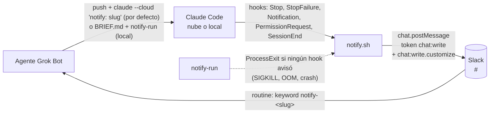

# Detalles técnicos

[← README](../README.md) · [Instalación](instalacion.md) · [Problemas comunes](problemas-comunes.md)

## Formato del mensaje

Diagrama técnico (hooks, `notify-run` y Slack):



Mensaje publicado:

```
*Claude Code*
• *evento:* `StopFailure` · `error=rate_limit`
• *sesión:* <https://claude.ai/code/session_abc|session_abc>
• *repo:* `owner/name`
• *rama:* `feature/x`
• *agente:* `notify-dev-fe`
• *tarea:* `x`
```


Se publica como un solo campo `text` (sin `blocks`), así el keyword `notify-<slug>` queda en el texto que matchea la routine. Un campo por línea, el mismo texto sirve para personas, scripts y agentes:

- **Título:** siempre `*Claude Code*` (sin emoji ni viñeta). Cada línea de campo empieza con `• ` (U+2022 + espacio).
- **`evento`:** siempre. Si hay detalle va en un segundo span en la misma línea: `error=rate_limit` (StopFailure), `type=permission_prompt` (Notification), `tool=Bash` (PermissionRequest), `reason=other` (SessionEnd), `exit=137` (ProcessExit).
- **`sesión`:** en la nube, link a la sesión cuyo texto es el id: `<https://claude.ai/code/session_xxx|session_xxx>`; en local, el `session_id` en código (`` `id` ``).
- **`repo`:** `owner/name` del `git remote get-url origin` (soporta https y ssh, quita `.git` y nunca muestra credenciales ni host).
- **`rama`**, **`agente`** (`notify-<slug>`, el keyword de la routine; `desconocido` si no se sabe) y **`tarea`** (la rama sin el prefijo `feature/`, `hotfix/` o `release/`: `feature/x` → `x`; otra rama queda igual; sin rama, p.ej. HEAD detached, no hay tarea).
- Los campos vacíos o `-` se omiten con su línea (p.ej. sin remote no hay `*repo:*`).

**Cómo parsearlo:** cada línea después del título es `• *<campo>:* <valor>` (regex `^• \*([^*]+):\* (.*)$`); el valor va entre backticks o, en `sesión` en la nube, como `<url|session_xxx>` (la URL es lo que está entre `<` y `|`; el texto del link, entre `|` y `>`, es el id de sesión). La routine identifica al agente por la línea `*agente:*` `` `notify-<slug>` ``.

**Payload de `chat.postMessage`** (ejemplo con los defaults):

```json
{"channel":"C0123456789","text":"*Claude Code*\n• *evento:* `Stop`\n• *sesión:* `s1`\n• *agente:* `notify-dev-fe`","username":"Claude Code","icon_url":"https://claude.ai/images/claude_app_icon.png"}
```

`username` (default `Claude Code`, se cambia con `SLACK_NOTIFY_USERNAME`) e `icon_url` (default `https://claude.ai/images/claude_app_icon.png`, se cambia con `SLACK_NOTIFY_ICON_URL`) van siempre, con y sin `jq`. Para que Slack los use, el bot necesita el scope **`chat:write.customize`**; sin él Slack los ignora **sin dar error** y el mensaje sale con el nombre e ícono de la app.

**A quién avisar:** el prompt de la tarea lleva una línea sola `notify: <agent-slug>`, p.ej.:

```
notify: dev-fe
Arreglá el login roto. No toques la base. Commiteá y hacé push de la rama.
```

El hook lee el `transcript_path` del JSON del hook y busca esa línea (`^[[:space:]]*notify:[[:space:]]*([a-z0-9-]+)[[:space:]]*$`) en el **primer** mensaje del usuario de la sesión (se saltean los mensajes meta, de sidechain y los `tool_result`; el contenido puede ser texto o bloques `text`). Una línea `notify:` en un mensaje posterior no cuenta. No hace falta crear archivos ni variables por tarea, así que funciona igual en la nube y en local, y varias sesiones en la misma rama pueden avisar a agentes distintos.

Si el primer mensaje no la trae, se usa la variable de entorno `NOTIFY_AGENT`. Si tampoco está, **igual se avisa**, con `` • *agente:* `desconocido` `` y sin ningún keyword `notify-`: el aviso queda en el canal pero no despierta a nadie.

El único `notify-` real del mensaje es el keyword de la línea `*agente:*`: en el resto (tarea, rama, repo, detalle) cada `notify-` se reemplaza por `notify‐` (guion U+2010) y `&`, `<`, `>` se escapan, así una tarea o una rama no pueden despertar a otro agente ni hacer ping con `<!channel>`, `<@U…>` o `<#C…>`.

## Contenido

| Ruta | Qué es |
| :- | :- |
| `hooks/notify.sh` | El hook. Lee el JSON de stdin, filtra, deduplica y publica. Siempre sale 0. Usa `jq`; sin `jq` tiene un fallback con `sed`/`awk` pensado como red de seguridad, no como modo normal. |
| `hooks/settings.json` | Bloque `hooks` para `~/.claude/settings.json` o `.claude/settings.json`. |
| `local/install.sh` | Instalación local: copia el hook a `~/.claude/hooks/grokbot-notify.sh`, `notify-run` a `~/.local/bin`, mergea los hooks con `jq` sin pisar lo existente y crea `~/.config/grokbot-claude-code/env` (modo 600) con placeholders. `--uninstall` los saca. |
| `local/notify-run` | Wrapper de `claude` (argumentos tal cual). Si al salir ningún hook avisó, publica un aviso `ProcessExit` · `exit=<código>`. |
| `local/check-slugs` | Chequea una lista de slugs (formato, duplicados y colisión por substring entre `notify-<a>` y `notify-<b>`). Sale 0 ok, 1 con problemas, 2 sin slugs. |
| `cloud/setup.sh` | Setup script auto-contenido para environments de claude.ai/code (embebe `notify.sh`). Generado con `bash cloud/build.sh`. |
| `cloud/build.sh` | Regenera `cloud/setup.sh`; con `--check` falla si quedó desactualizado. |
| `skill/claude-code-task/SKILL.md` | Skill de Grok Bot actualizada: nube por defecto (`claude --cloud`), local (worktree + `notify-run`) como fallback, línea `notify: <slug>` en el prompt, routine, sin polling. |
| `skill/claude-code-notify-setup/SKILL.md` | Skill de onboarding: le pregunta al usuario canal, channel id y bots; flujo coordinador (varios bots) o por agente; slugs chequeados con `local/check-slugs`, routine, memoria y una prueba por bot. |
| `tests/simulate.sh` | Simulación de eventos contra el hook sin red (`DRY_RUN=1`). |
| `tests/test-transcript-agent.sh` | Agente desde la línea `notify:` del transcript (fixtures en `tests/fixtures/`), fallbacks y tarea desde la rama, con y sin `jq`. |
| `tests/test-scripts.sh` | POST real del hook contra un servidor HTTP falso local, `notify-run`, `local/install.sh` (+ `--uninstall`), `cloud/build.sh` y `cloud/setup.sh` en un HOME temporal. |
| `tests/test-check-slugs.sh` | Casos de `local/check-slugs`. |
| `tests/lint-skills.sh` | Frontmatter de las skills, rutas del repo citadas, placeholders, canal sin hardcodear y nube por defecto en la skill de tareas. |
| `tests/secret-scan.sh` | Busca tokens/ids con pinta de reales en los archivos del repo. |
| `tests/run-all.sh` | Corre todos los tests y resume. |
| `docs/` | Instalación, problemas comunes y estos detalles técnicos. |
| `ci/github-workflow-test.yml` | CI: `shellcheck` + `bash tests/run-all.sh` en cada PR y push a `main`. Movelo a .github/workflows/test.yml para activarlo. |

## Comportamiento verificado

Verificado con `claude -p` real en Linux (Stop + dedup de SessionEnd, Stop en pausa + SIGKILL → ProcessExit), con experimentos previos de hooks (SessionEnd en SIGINT/SIGTERM, subagentes con `agent_id`) y con `tests/simulate.sh` + la referencia de hooks para el resto.

| Situación | Qué se publica |
| :- | :- |
| Fin normal del turno (`claude -p`) | `Stop`. El `SessionEnd` siguiente se descarta (dedup por sesión). |
| Stop con tareas en segundo plano o crons pendientes (`background_tasks`/`session_crons`) | Nada: la sesión está en pausa. Avisa el Stop final, el `SessionEnd` o el `ProcessExit`. |
| Error de API / rate limit / usage limit | `StopFailure` · `error=<tipo>`. |
| Pide permiso | `PermissionRequest` · `tool=<tool>` al instante, solo con el nombre de la tool (nunca el `tool_input`: el comando puede traer credenciales). El `Notification permission_prompt` posterior (≈6 s) se descarta si hubo PermissionRequest en los últimos 120 s. |
| Elicitation MCP / sesión interactiva ociosa | `Notification` · `type=elicitation_dialog\|elicitation_url_dialog\|idle_prompt` (idle se descarta si ya hubo Stop en ese turno). |
| `--max-turns`, SIGINT/SIGTERM, salida sin Stop | `SessionEnd` · `reason=<motivo>` (timeout del hook 10 s; el default de SessionEnd es 1.5 s). |
| SIGKILL / OOM / crash (con `notify-run`) | `ProcessExit` · `exit=<código>` (p.ej. 137), con el session_id si algún hook llegó a verlo. |
| Subagentes | Nada: se descarta todo evento con `agent_id`. No se usa `SubagentStop`. |
| Sin línea `notify:` en el primer mensaje ni `NOTIFY_AGENT` | El aviso igual, con agente `desconocido` y sin keyword `notify-` (no despierta a nadie). |

El hook nunca bloquea ni hace fallar a Claude: siempre sale 0 y no escribe JSON de decisión en stdout. Estado de dedup y log en `${XDG_STATE_HOME:-~/.local/state}/grokbot-claude-code/` (privado del usuario, no en `/tmp`). La marca de dedup se escribe solo si el envío salió bien.

### Huecos conocidos

- **SIGKILL/OOM/crash sin `notify-run`** (o si muere el propio `notify-run`): no hay aviso. En la nube no hay wrapper; depende de los hooks.
- **Sesiones interactivas largas:** cada turno avisa con `Stop` (dedup por `prompt_id`), lo que puede ser ruidoso.
- **`sesión` en la nube:** usa `https://claude.ai/code/$CLAUDE_CODE_REMOTE_SESSION_ID` si esa variable existe; si no, el `session_id` del hook. Un aviso real desde la nube llevó un session id; el fallback se mantiene por si cambia.
- **Keyword por substring:** si el keyword de un agente está contenido en el de otro (`notify-dev` / `notify-dev-ml`), despierta al agente equivocado. Ver [onboarding](instalacion.md#4-onboarding-de-cada-agente-routine).
- Si Slack responde error (token inválido, bot fuera del canal), solo queda en `notify.log`. `curl` usa `--connect-timeout 3 --max-time 4` y un reintento ante errores transitorios; si igual falla, no queda marca de dedup y el próximo evento terminal (o el `ProcessExit` de `notify-run`) vuelve a intentar.

## Tests

```bash
bash tests/run-all.sh
shellcheck hooks/notify.sh local/notify-run local/install.sh local/check-slugs cloud/*.sh tests/*.sh
```

Todo corre sin red y sin tokens reales, con un `HOME` temporal (no toca tu `~/.claude` ni tu config). Cada archivo imprime `pasaron: N  fallaron: M` y sale ≠0 si algo falla; también se pueden correr sueltos:

| Test | Qué cubre |
| :- | :- |
| `tests/simulate.sh` | Eventos de Claude Code contra el hook en `DRY_RUN` (formato exacto con y sin `jq`, con y sin URL, campos vacíos, caracteres especiales, dedup, subagentes, neutralizado de texto, fallback sin `jq`, `notify-run`, `cloud/setup.sh`, `local/install.sh`). |
| `tests/test-scripts.sh` | POST real del hook contra un servidor HTTP falso en `127.0.0.1` (`python3`), apuntado con `SLACK_API_URL`: canal, texto exacto, keyword y header `Authorization` (y sin `Authorization` propio en la nube, con la sesión como link). `notify-run` con un `claude` falso (exit 137 → `ProcessExit`; Stop → sin `ProcessExit`). `local/install.sh` idempotente y `--uninstall`. `cloud/build.sh --check` y build en una copia. `cloud/setup.sh` en un HOME limpio, idempotente. |
| `tests/test-transcript-agent.sh` | Agente desde la línea `notify:` del primer mensaje del usuario en transcripts de prueba (`tests/fixtures/`: content string y array, sin línea, línea en un mensaje posterior, dos transcripts en la misma rama), fallbacks `NOTIFY_AGENT` → `desconocido` sin keyword, y tarea desde la rama (`feature/`, `hotfix/`, `release/`, rama sin prefijo, HEAD detached), con y sin `jq`. |
| `tests/test-check-slugs.sh` | `local/check-slugs`: set válido, `notify-dev` vs `notify-dev-ml`, duplicados, mayúsculas/espacios, prefijo `notify-`, stdin y sin input. |
| `tests/lint-skills.sh` | Frontmatter de cada skill (`name` = carpeta, `description`), rutas del repo citadas en skills y README existen, sin ids/tokens con pinta de reales, regla de colisión y `local/check-slugs` en la skill de setup, sin canal hardcodeado (solo `#<canal>`), la skill `claude-code-task` declara la nube por defecto (`claude --cloud`) y local como fallback, las skills piden la línea `notify: <slug>`, y ningún archivo trackeado menciona el viejo archivo de configuración por carpeta ni la variable de tarea eliminada. |
| `tests/secret-scan.sh` | Archivos trackeados y no ignorados (`git ls-files -co --exclude-standard`): tokens `xox*`, ids de canal/usuario, webhooks y sesiones con pinta de reales. Solo se permiten los placeholders (`C0123456789`, `U0123456789`, `xoxb-REPLACE_ME`). |

`SLACK_API_URL` (en `hooks/notify.sh`) es solo una perilla de test: en uso real no se toca.

Si cambiás `hooks/notify.sh` o `hooks/settings.json`, regenerá `cloud/setup.sh` con `bash cloud/build.sh` (el test falla si queda desactualizado).

CI: [`ci/github-workflow-test.yml`](../ci/github-workflow-test.yml) corre `shellcheck` y `bash tests/run-all.sh` en cada PR y en cada push a `main` (sin secretos). Para activarlo, movelo a .github/workflows/test.yml (pushear workflows requiere un token con scope `workflow`).
